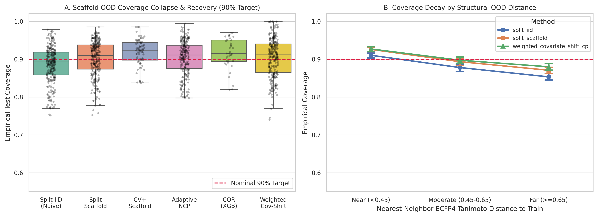
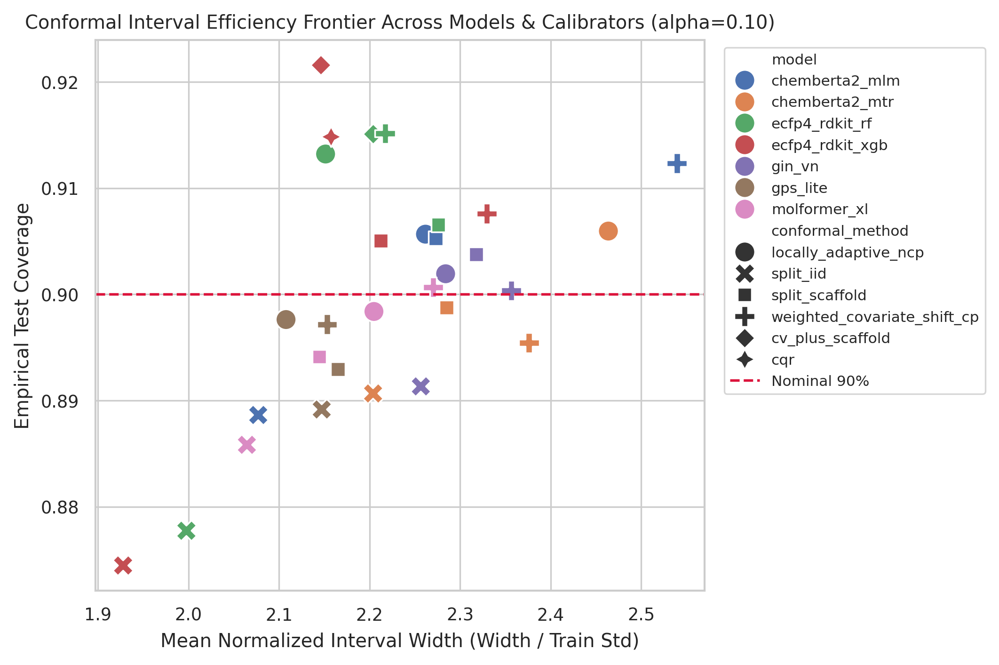
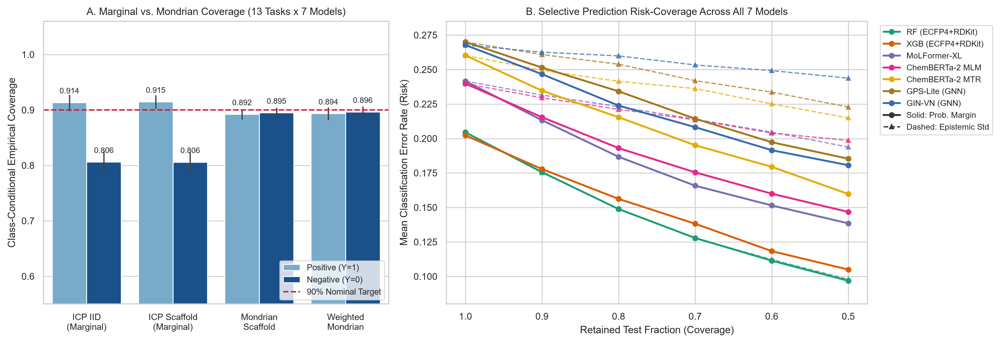
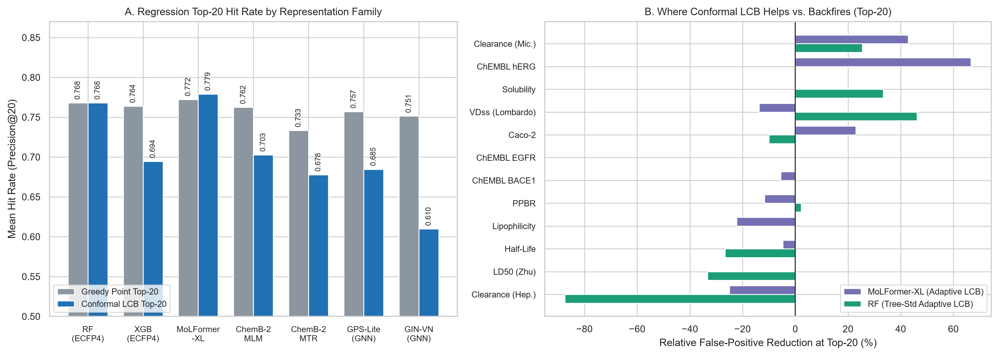
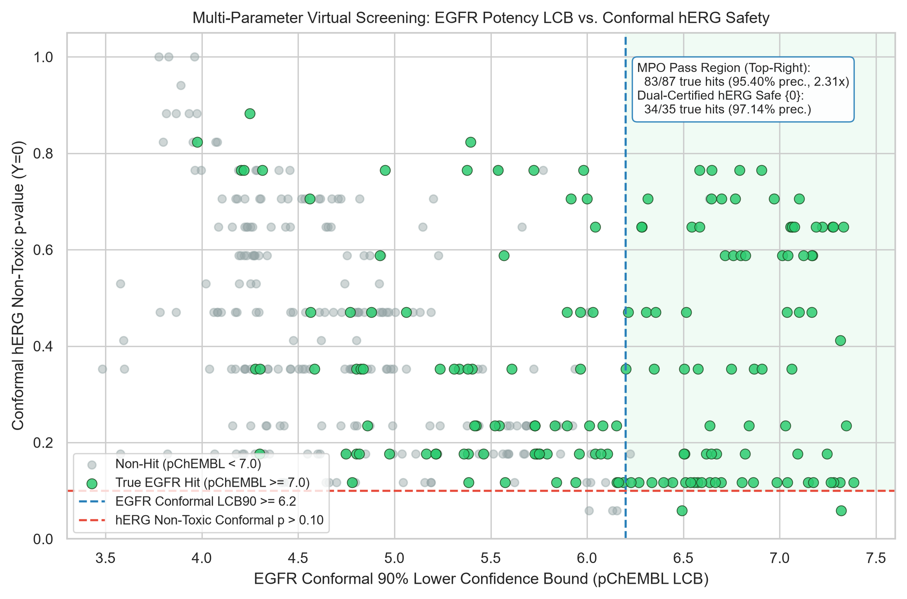

# Conformal Risk Control & Out-of-Distribution Calibration Across Seven Molecular Representation Families for ADMET & Virtual Screening

[](https://doi.org/10.5281/zenodo.24496512)
[English](README.md) | [简体中文](README_zh.md) | **[Formal Academic PDF (`ADMET_Conformal_Technical_Report.pdf`)](ADMET_Conformal_Technical_Report.pdf)** | [`DIRECTION_D_EXPERIMENTAL_PLAN.md`](DIRECTION_D_EXPERIMENTAL_PLAN.md) | **[🧬 Companion Protein + Agent Suite (`flip2-plm-probing-benchmark`)](https://github.com/Der134/flip2-plm-probing-benchmark)**

This repository delivers a leakage-resistant, end-to-end **Cross-Modal Conformal Uncertainty & Out-of-Distribution (OOD) Virtual Screening Benchmark** spanning **7 molecular representation families** (**2 fingerprint tree ensembles + 3 frozen Chemical Language Models + 2 pure-PyTorch 5-member GNN ensembles**) across **25 real-world molecular property and bioactivity tasks** (**all 22 official TDC `ADMET_Group` assays + 3 ChEMBL `IC50` medicinal chemistry targets**, **3 scaffold seeds each**; **51,827 globally deduplicated canonical SMILES**; **4,344 conformal evaluations**).

> **TL;DR for drug-discovery practitioners:** Across all **7 model families × 25 Bemis-Murcko scaffold-split tasks (`shared_scaffolds = 0`)**:
> 1. **Representations are deeply complementary:** Fingerprint trees lead ADMET classification (`RF` ROC-AUC **`0.8306`**, ECE **`0.0834`**) and congeneric ChEMBL SAR (`XGB` MAE **`0.6023`**), whereas **`MoLFormer-XL`** achieves the lowest regression MAE across all 12 tasks (**`7.0292`**, TDC-9 **`9.1545`** vs. `RF` `10.2731`) and **`GPS-Lite`** achieves the tightest locally adaptive conformal intervals (**`2.1077`**).
> 2. **IID conformal collapse is universal:** Naive `split_iid` under-covers across every backbone (**`0.8854`** vs. `90%`, decaying to **`0.8532`** in Far OOD $d_{\text{NN}} \ge 0.65$), while scaffold calibrators restore validity (`split_scaffold` `0.9009`, `locally_adaptive_ncp` `0.9038`, `cqr` `0.9148` with `0.8985` Far OOD, `cv_plus_scaffold` `0.9183`).
> 3. **Marginal ICP fails bilaterally on imbalanced panels:** It under-covers both minority-positive CYP assays (`Y=1` `0.8354`/`0.8563`) and majority-positive absorption/toxicity assays (`Y=0` `0.6227`/`0.6388`), which `mondrian_scaffold` restores cleanly (`0.8923` / `0.8950`).
> 4. **Decision boundary condition:** Conformal LCB reranking boosts `MoLFormer-XL` (`+4.14%` Top-20 FP reduction; `chembl240_herg` `+66.7%`, `clearance_microsome_az` `+42.9%`) and `RF` on noisy PK (`vdss_lombardo` `+71.0%` at $K=10$), yet backfires on heteroscedastic ensembles (`GIN-VN` `-68.8%`); deployed as a **threshold gate** on ChEMBL EGFR × TDC hERG (`n=400`), joint conformal gating achieves **`95.40%` precision (`83/87`, `34/35 = 97.14%` among dual-certified hERG-safe leads)**.

---

## Key Empirical Findings (Full 7 Models × 25 Tasks × 3 Seeds)

### 1. Cross-Modal Point Prediction Across 3 Representation Paradigms
Every task (`25/25`) exhibits **`0` shared Bemis-Murcko scaffolds** between `train_val` (`70,230` rows) and `test` (`17,577` rows), with mean nearest-neighbor ECFP4 Tanimoto distance $d_{\text{NN}} = \mathbf{0.5191}$ (TDC 22: `0.5425`, peaking at `0.6677` on `dili`; ChEMBL 3: `0.3473`) and `30.34%` of test compounds in the **Far OOD (`d_NN >= 0.65`)** regime.

| Model Family | Paradigm | 13-Cls ROC-AUC | 13-Cls PR-AUC | 13-Cls ECE | TDC 9-Reg MAE | ChEMBL 3-Reg MAE | 12-Reg Spearman $\rho$ | Mean Rank (Wins / 25) |
|---|---|---:|---:|---:|---:|---:|---:|---:|
| `ecfp4_rdkit_rf` | Fingerprint Tree (UQ) | **0.8306** | **0.8080** | **0.0834** | 10.2731 | 0.6369 | **0.6189** | **2.64** (8) |
| `ecfp4_rdkit_xgb` | Fingerprint GBDT (CQR) | 0.8263 | 0.8044 | 0.1008 | 10.2826 | **0.6023** | 0.6119 | 2.76 (**9**) |
| `molformer_xl` | Frozen CLM (768-D, 5x MLP) | 0.8099 | 0.7931 | 0.1132 | **9.1545** | 0.6532 | 0.5884 | 3.84 (2) |
| `chemberta2_mlm` | Frozen CLM (384-D, 5x MLP) | 0.8042 | 0.7899 | 0.1129 | 9.1848 | 0.6810 | 0.5713 | 4.60 (4) |
| `chemberta2_mtr` | Frozen CLM (384-D, 5x MLP) | 0.7882 | 0.7728 | 0.1106 | 9.7423 | 0.7125 | 0.5683 | 5.00 (0) |
| `gps_lite` | 2D GNN+SDPA (5x Ensemble) | 0.7833 | 0.7760 | 0.1250 | 9.8053 | 0.6637 | 0.5624 | 4.36 (1) |
| `gin_vn` | 2D GIN+VN (5x Ensemble) | 0.7865 | 0.7717 | 0.1154 | 9.5195 | 0.7319 | 0.5651 | 4.80 (1) |

### 2. Universal IID Coverage Collapse & Cross-Modal Efficiency Frontier (`RQ1`–`RQ2`)
Across **2,160 regression conformal evaluations** (7 models × 12 tasks × 3 seeds × 2 $\alpha$), naive `split_iid` under-covers across every backbone (**`0.8854`** at $\alpha=0.10$; **`0.7727`** at $\alpha=0.20$), collapsing hardest on `ld50_zhu` (**`0.7906`**) and `chembl203_egfr` (**`0.8340`**) and decaying monotonically with $d_{\text{NN}}$ (`Near 0.9102` $\rightarrow$ `Moderate 0.8777` $\rightarrow$ `Far 0.8532`).

| Calibrator ($\alpha=0.10$) | Models Covered | Coverage | Far (`>=0.65`) Cov | Norm. Width | Finite Rate | ESS | Cross-Modal Highlight |
|---|---:|---:|---:|---:|---:|---:|---|
| `split_iid` (Naive) | 7 | 0.8854 | 0.8532 | 2.0964 | 100.0% | 304.6 | Invalid across every architecture |
| `split_scaffold` | 7 | 0.9009 | 0.8706 | 2.2390 | 100.0% | 328.4 | `molformer_xl` tightest (`2.1445`) |
| `locally_adaptive_ncp` | 6 UQ | 0.9038 | 0.8868 | 2.2456 | 100.0% | 328.4 | **`gps_lite` tightest overall (`2.1077`)**, `RF` `2.1514` |
| `cqr` (XGB Quantile) | XGB | 0.9148 | **0.8985** | **2.1575** | 100.0% | 328.4 | Best Far-OOD single-split coverage |
| `cv_plus_scaffold` (5-fold) | RF/XGB | **0.9183** | 0.8932 | 2.1752 | 100.0% | **2,358.2** | Highest overall coverage & ESS |
| `weighted_covariate_shift_cp` | 7 | 0.9041 | 0.8798 | 2.3203 | 95.2% | 161.5 (med 35.3) | `domain_auc = 0.7119`; abstains on `ld50_zhu` s3 (`0.0074` finite) |




### 3. Bilateral Minority Rescue via Mondrian Calibration & Selective Prediction (`RQ3`)
Across **2,184 classification evaluations** (7 models × 13 TDC tasks × 3 seeds × 2 $\alpha$), standard marginal ICP (`icp_iid` `0.8964`, `icp_scaffold` `0.8942`) masks **two-sided minority failure**:
- **Majority-positive Absorption/Tox panels (`hia_hou`, `bioavailability_ma`, `bbb_martins`, `herg`):** Negative-class ($Y=0$) coverage crashes to **`0.6227` / `0.6388`** (`hia_hou`: **`0.5432` / `0.6367`**), pulling the 13-task $Y=0$ average down to `0.8062` / `0.8059`.
- **Minority-positive CYP panels (`cyp2c9/2d6_veith`, `cyp2c9/2d6_substrate`):** Positive-class ($Y=1$) coverage drops to **`0.8354` / `0.8563`** (`cyp2c9_substrate`: **`0.7293` / `0.7920`**, `cyp2d6_veith`: **`0.7971` / `0.8022`**).
- **Mondrian Recovery:** `mondrian_scaffold` balances both classes simultaneously (**`Y=1: 0.8923`, `Y=0: 0.8950`** overall; CYP $Y=1 \rightarrow \mathbf{0.9040}$, Absorption/Tox $Y=0 \rightarrow \mathbf{0.9157}$), and `weighted_mondrian_cp` reaches **`0.8968`** overall (`0.8936` / `0.8965`, singleton accuracy `0.8037`).
- **Selective Prediction (`fig3B`):** Retaining the `50%` most confident compounds slashes error across all 7 models, with `prob_margin` consistently outperforming `epistemic_std` on neural models (`molformer_xl` `24.16% -> 13.85%` vs. `19.38%`), while both signals halve error identically on `RF` (`20.45% -> 9.69%` / `9.79%`).



### 4. "Buy Top-K" Screening Boundary Condition & EGFR × hERG MPO (`RQ4`)
- **Cross-Modal Top-20 Regression (`fig4`):** **`molformer_xl`** is the strongest regression LCB reranker (`0.7722 -> 0.7792` hit rate, **`+4.14%`** mean FP reduction; `chembl240_herg` `+66.7%`, `clearance_microsome_az` `+42.9%`, `caco2_wang` `+22.9%`), and **`ecfp4_rdkit_rf`** delivers large gains on noisy OOD PK (`vdss_lombardo` **`+71.0%`** at $K=10$ / **`+46.2%`** at $K=20$, `solubility_aqsoldb` `+33.3%`). Conversely, heteroscedastic variance in `gin_vn` (`-68.8%`), `xgb` CQR (`-48.9%`), and `chemberta2` (`-39.5%` / `-33.6%`) penalizes high-activity leads whose spread correlates with target magnitude.
- **EGFR (`CHEMBL203`) × Conformal hERG MPO (`fig5`):** On `400` unseen EGFR compounds (`165` hits `pChEMBL >= 7.0`, `41.25%` base rate), gating on `pred_lcb90 >= 6.2 & herg_pval_safe0 > 0.10` isolates **`87` leads with `83` true hits (`95.40%` precision, `2.31x` enrichment, mean `pChEMBL = 8.360`)**; restricting to dual-certified hERG-safe `{0}` singletons yields **`34/35 = 97.14%` hit precision** (vs. only `3/10` and `8/20` certified hERG-safe in greedy Top-10/Top-20).




---

## Repository Structure & Reproducibility

| Component | Path | Notes |
|---|---|---|
| Formal Academic PDF Report | [`ADMET_Conformal_Technical_Report.pdf`](ADMET_Conformal_Technical_Report.pdf) | Full 7-model 2-column Typst report ([`paper_d.typ`](paper_d.typ), [`refs_d.bib`](refs_d.bib)) |
| Full Experimental Plan & Protocol | [`DIRECTION_D_EXPERIMENTAL_PLAN.md`](DIRECTION_D_EXPERIMENTAL_PLAN.md) | 25-task protocol, conformal math, and RQ1–RQ4 design |
| Colab / Local Execution Handbook | [`COLAB_EXECUTION_HANDBOOK.md`](COLAB_EXECUTION_HANDBOOK.md) | Dual-account GPU sharding, measured Colab timings, Drive reuse |
| Core Python Modules | [`admet_core.py`](admet_core.py), [`conformal_ood.py`](conformal_ood.py), [`gin_gps_model.py`](gin_gps_model.py) | Security-hardened fetchers, PyTDC scaffold split, conformal suite, vectorized GPU-resident GNNs |
| Reproducible Pipelines | [`d_notebook_01_data_prep_ecfp_xgboost.ipynb`](d_notebook_01_data_prep_ecfp_xgboost.ipynb), [`d_notebook_02_clm_gnn_representation_gpu.ipynb`](d_notebook_02_clm_gnn_representation_gpu.ipynb), [`d_notebook_03_conformal_ood_virtual_screening.ipynb`](d_notebook_03_conformal_ood_virtual_screening.ipynb), [`run_full_cpu_benchmark.py`](run_full_cpu_benchmark.py) | Three-stage Colab pipeline (`NUM_WORKERS=2` sharding) + local CPU runner |
| Verified 7-Model Tables (10 CSVs) | [`results/tables/`](results/tables/) | Full 7-model × 25-task × 3-seed point metrics, conformal, Tanimoto bins, selective & Top-K tables |
| Publication Figures (300-DPI) | [`results/figures/`](results/figures/) + [`regenerate_paper_figures.py`](regenerate_paper_figures.py) | `fig1`–`fig5` PNGs |

### Quick Local Verification

```bash
python verify_direction_d.py      # Security, split & conformal unit checks (0 GPU)
python verify_gpu_nb02_mock.py    # End-to-end Stage 2->3 mock GPU handoff check (0 GPU)
python regenerate_paper_figures.py # Rebuild polished Fig 3–5 from verified CSVs
```

---

## Citations

- **TDC:** Huang et al. (2021), *Therapeutics Data Commons*, NeurIPS Datasets & Benchmarks
- **Conformal Prediction:** Vovk, Gammerman & Shafer (2005), *Algorithmic Learning in a Random World*; Barber et al. (2021), *Annals of Statistics* (CV+); Romano, Patterson & Candès (2019), *NeurIPS* (CQR); Tibshirani et al. (2019), *NeurIPS* (Covariate Shift CP)
- **Molecular Representations:** Ross et al. (2022), *Nat. Mach. Intell.* (MoLFormer-XL); Ahmad et al. (2022) (ChemBERTa-2); Xu et al. (2019), *ICLR* (GIN); Rampášek et al. (2022), *NeurIPS* (GraphGPS)
