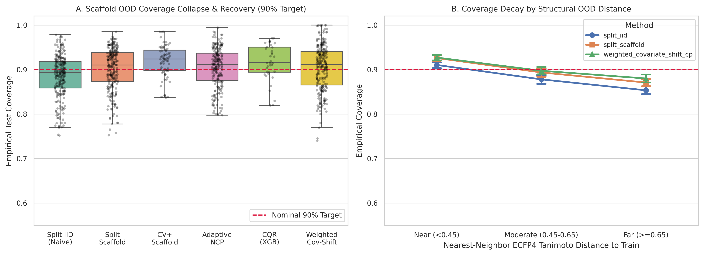
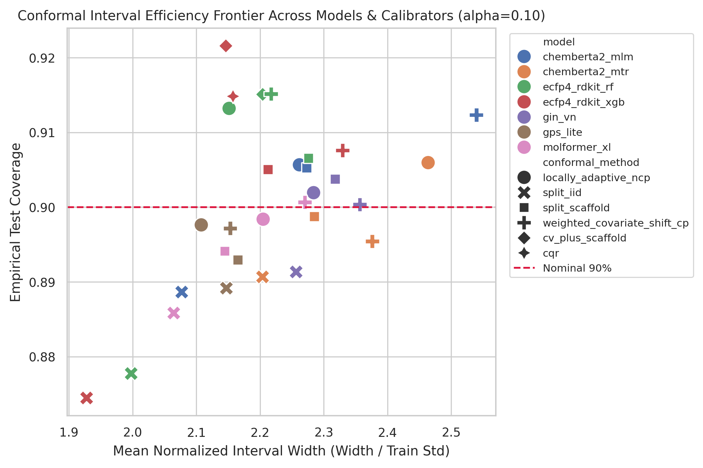
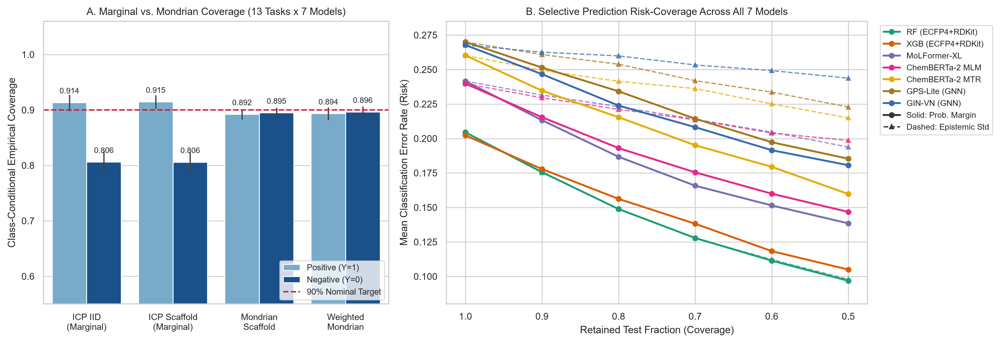
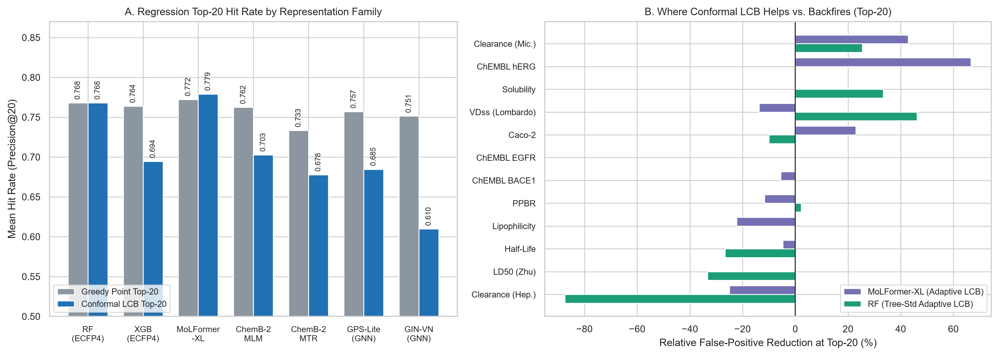
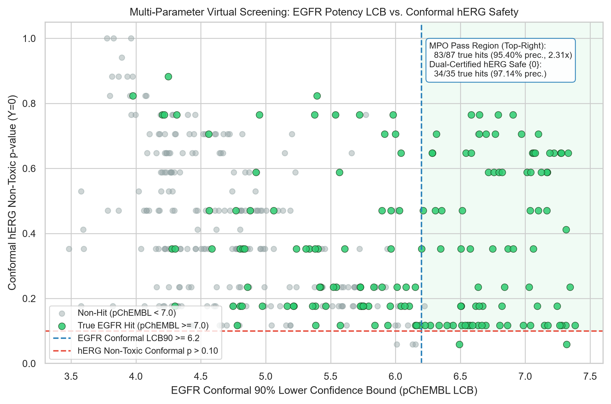

# 方向 D：跨七大分子表征族的 ADMET 骨架 OOD 保形预测与风险可控虚拟筛选基准

[](https://doi.org/10.5281/zenodo.24496512)
[English](README.md) | [简体中文](README_zh.md) | **[正式英文双栏学术 PDF 报告 (`ADMET_Conformal_Technical_Report.pdf`)](ADMET_Conformal_Technical_Report.pdf)** | [`DIRECTION_D_EXPERIMENTAL_PLAN.md`](DIRECTION_D_EXPERIMENTAL_PLAN.md) | **[🧬 姊妹篇：蛋白 FLIP2 + Agent 审计基准](https://github.com/Der134/flip2-plm-probing-benchmark)**

本项目构建并完整实测了一个防泄漏、全栈可复现的**跨模态分子性质保形不确定性与 OOD 虚拟筛选基准**，覆盖 **7 大分子表征模型族**（**2 个指纹树模型 + 3 个冻结化学语言模型 CLM + 2 个纯 PyTorch 5 成员 2D GNN 深度集成**）× **25 个真实药物发现任务**（**TDC `ADMET_Group` 官方全部 22 项任务 + ChEMBL `IC50` 3 项真实药化靶点**，每任务 **3 个骨架种子**，全局去重 **`51,827` 条规范 SMILES**，共 **`4,344` 组保形评测**）。

> **一句话给药物发现从业者：** 在 **7 大模型族 × 25 个 Bemis-Murcko 零重叠骨架任务（`shared_scaffolds = 0`）** 上：
> 1. **三大表征范式高度互补：** 分子指纹树在 ADMET 分类（`RF` ROC-AUC **`0.8306`**、ECE **`0.0834`**）与同系物 ChEMBL SAR（`XGB` MAE **`0.6023`**）上依然最强；**`MoLFormer-XL`** 拿下全 12 回归最低 MAE（**`7.0292`**，TDC-9 **`9.1545`** vs `RF` `10.2731`）；**`GPS-Lite`** 给出全场最紧致的自适应保形区间（归一化宽度 **`2.1077`**）。
> 2. **IID 保形坍缩跨架构普遍存在：** 朴素 `split_iid` 在全部 7 个模型上均失覆盖（均值 **`0.8854`** vs `90%`，远距离 OOD $d_{\text{NN}} \ge 0.65$ 跌至 **`0.8532`**），而骨架感知校准器全线恢复有效覆盖（`split_scaffold` `0.9009`、`locally_adaptive_ncp` `0.9038`、`cqr` `0.9148` 且远距离 OOD 达 `0.8985`、`cv_plus_scaffold` `0.9183`）。
> 3. **边际 ICP 存在双向少数类盲区：** 在 13 项不平衡分类任务中，边际 ICP 既在少数阳性 CYP 任务上失覆盖 ( $Y=1$ : `0.8354`/`0.8563` )，又在多数阳性吸收/毒性任务上崩塌 ( $Y=0$ : `0.6227`/`0.6388` )；`mondrian_scaffold` 将两类同步拉回 **`0.8923` / `0.8950`**。
> 4. **保形筛选的适用边界与 MPO 实战：** Top-20 LCB 重排在 **`MoLFormer-XL`** 上取得整体正收益（假阳性降幅 **`+4.14%`**，`chembl240_herg` `+66.7%`、`clearance_microsome_az` `+42.9%`），在 `RF` 高噪声 PK 任务上收益显著（`vdss_lombardo` $K=10$ **`+71.0%`**），但在异方差深度集成（如 `GIN-VN` `-68.8%`）上会因方差与活性幅值耦合而反噬；作为**多参数阈值门控**用于 ChEMBL EGFR × TDC hERG（`n=400`）时，精确率从 `41.25%` 跃升至 **`95.40%`（`83/87`，双重 hERG 安全认证单例达 `34/35 = 97.14%`）**。

---

## 核心实测发现（完整 7 大模型族 × 25 任务 × 3 种子）

### 1. 三大分子表征范式点预测全景对比
全部 `25/25` 任务的 `train_val`（`70,230` 条）与 `test`（`17,577` 条）严格满足 **`shared_scaffolds = 0`**，最近邻 ECFP4 Tanimoto 距离均值 $d_{\text{NN}} = 0.5191$（TDC 22 项 `0.5425`，`dili` 高达 `0.6677`；ChEMBL 3 项 `0.3473`），平均 **`30.34%`** 测试分子落入 **Far OOD (`d_NN >= 0.65`)**。

| 模型族 | 表征范式 | 13 分类 ROC-AUC | 13 分类 PR-AUC | 13 分类 ECE | TDC 9 回归 MAE | ChEMBL 3 回归 MAE | 12 回归 Spearman ρ | 平均排名（胜场 / 25） |
|---|---|---:|---:|---:|---:|---:|---:|---:|
| `ecfp4_rdkit_rf` | 专家指纹树（树方差 UQ） | **0.8306** | **0.8080** | **0.0834** | 10.2731 | 0.6369 | **0.6189** | **2.64** (8) |
| `ecfp4_rdkit_xgb` | 专家指纹 GBDT（CQR） | 0.8263 | 0.8044 | 0.1008 | 10.2826 | **0.6023** | 0.6119 | 2.76 (**9**) |
| `molformer_xl` | 冻结 CLM（768 维 + 5x MLP） | 0.8099 | 0.7931 | 0.1132 | **9.1545** | 0.6532 | 0.5884 | 3.84 (2) |
| `chemberta2_mlm` | 冻结 CLM（384 维 + 5x MLP） | 0.8042 | 0.7899 | 0.1129 | 9.1848 | 0.6810 | 0.5713 | 4.60 (4) |
| `chemberta2_mtr` | 冻结 CLM（384 维 + 5x MLP） | 0.7882 | 0.7728 | 0.1106 | 9.7423 | 0.7125 | 0.5683 | 5.00 (0) |
| `gps_lite` | 2D GNN+全局注意力（5x 集成） | 0.7833 | 0.7760 | 0.1250 | 9.8053 | 0.6637 | 0.5624 | 4.36 (1) |
| `gin_vn` | 2D GIN+虚拟节点（5x 集成） | 0.7865 | 0.7717 | 0.1154 | 9.5195 | 0.7319 | 0.5651 | 4.80 (1) |

### 2. 跨架构 IID 覆盖率坍缩与区间效率前沿 (`RQ1`–`RQ2`)
在 **2,160 组回归保形评测** (7 模型 × 12 回归任务 × 3 种子 × 2 $\alpha$ 值) 上，朴素 `split_iid` 在全部模型上普遍失覆盖 ( $\alpha=0.10$ 均值 **`0.8854`**， $\alpha=0.20$ 跌至 **`0.7727`** )，在 `ld50_zhu`（**`0.7906`**）与 `chembl203_egfr`（**`0.8340`**）上坍缩最重，并随 $d_{\text{NN}}$ 单调下滑（`Near 0.9102` → `Moderate 0.8777` → `Far 0.8532`）。

| 校准器 (α = 0.10) | 涵盖模型 | 平均覆盖率 | Far (`>=0.65`) 覆盖 | 归一化宽度 | 有限率 | 有效样本量 ESS | 跨模态亮点 |
|---|---:|---:|---:|---:|---:|---:|---|
| `split_iid`（朴素 IID） | 7 | 0.8854 | 0.8532 | 2.0964 | 100.0% | 304.6 | 全架构一致失覆盖 |
| `split_scaffold` | 7 | 0.9009 | 0.8706 | 2.2390 | 100.0% | 328.4 | `molformer_xl` 区间最窄（`2.1445`） |
| `locally_adaptive_ncp` | 6 UQ | 0.9038 | 0.8868 | 2.2456 | 100.0% | 328.4 | **`gps_lite` 全场最窄（`2.1077`）**，`RF` `2.1514` |
| `cqr` (XGB 分位数) | XGB | 0.9148 | **0.8985** | **2.1575** | 100.0% | 328.4 | 远距离 OOD 鲁棒性最强 |
| `cv_plus_scaffold` (5 折) | RF/XGB | **0.9183** | 0.8932 | 2.1752 | 100.0% | **2,358.2** | 最高平均覆盖率与 ESS |
| `weighted_covariate_shift_cp` | 7 | 0.9041 | 0.8798 | 2.3203 | 95.2% | 161.5（中位 35.3） | 域判别 AUC `0.7119`；`ld50_zhu` s3 极端偏移自动拒答（`0.0074`） |




### 3. Mondrian 双向少数类挽救与 7 模型选择性预测 (`RQ3`)
在 **2,184 组分类评测** (7 模型 × 13 TDC 任务 × 3 种子 × 2 $\alpha$ 值) 上，标准边际 ICP（`icp_iid` `0.8964`、`icp_scaffold` `0.8942`）暴露出**双向少数类失覆盖**：
- **多数阳性吸收/毒性任务（`hia_hou`、`bioavailability_ma`、`bbb_martins`、`herg`）：** 阴性类 ( $Y=0$ ) 覆盖暴跌至 **`0.6227` / `0.6388`**（`hia_hou` 低至 **`0.5432` / `0.6367`**），将 13 项任务阴性均值拉低至 `0.8062` / `0.8059`。
- **少数阳性 CYP 代谢任务（`cyp2c9/2d6_veith`、`cyp2c9/2d6_substrate`）：** 阳性类 ( $Y=1$ ) 覆盖跌至 **`0.8354` / `0.8563`**（`cyp2c9_substrate` **`0.7293` / `0.7920`**，`cyp2d6_veith` **`0.7971` / `0.8022`**）。
- **Mondrian 同步修复：** `mondrian_scaffold` 将双侧同步拉回标称附近（总体 **`Y=1: 0.8923`, `Y=0: 0.8950`**；CYP $Y=1$ → **`0.9040`**，吸收/毒性 $Y=0$ → **`0.9157`**）；`weighted_mondrian_cp` 总体达 **`0.8968`**（`0.8936` / `0.8965`，单例准确率 `0.8037`）。
- **7 模型选择性预测（图 3B）：** 弃权 50% 高不确定分子后所有模型错误率均单调下降；神经模型上 **`prob_margin` 显著优于 `epistemic_std`**（如 `molformer_xl` 错误率 `24.16% -> 13.85%` vs `19.38%`），而 `RF` 上两种信号均将错误率减半（`20.45% -> 9.69%` / `9.79%`）。



### 4. “买 Top-K 分子”跨模态收益边界与 EGFR × hERG 多参数优化 (`RQ4`)
- **跨模态 Top-20 回归拆解（图 4）：** **`molformer_xl`** 是表现最好的回归 LCB 排序器（命中率 `0.7722 -> 0.7792`，假阳性相对削减 **`+4.14%`**；`chembl240_herg` `+66.7%`、`clearance_microsome_az` `+42.9%`、`caco2_wang` `+22.9%`）；**`ecfp4_rdkit_rf`** 在高噪声 OOD PK 上大幅降假阳性（`vdss_lombardo` $K=10$ **`+71.0%`** / $K=20$ **`+46.2%`**，`solubility_aqsoldb` `+33.3%`）。相反，`gin_vn`（`-68.8%`）、`xgb` CQR（`-48.9%`）及 `chemberta2`（`-39.5%` / `-33.6%`）因重尾回归上不确定度与目标幅值正相关，直接 LCB 重排会误杀高活性候选。
- **EGFR (`CHEMBL203`) × 保形 hERG 多参数门控（图 5）：** 在 `400` 个未见 EGFR 测试分子（`165` 真活性，基线命中率 `41.25%`）中，联合 `pred_lcb90 >= 6.2 & herg_pval_safe0 > 0.10` 锁定 **`87` 个高置信安全候选，含 `83` 个真活性（`95.40%` 精确率，`2.31x` 富集，平均 `pChEMBL = 8.360`）**；进一步限定为严格 Mondrian `{0}` 非心脏毒性单例认证时，命中率达 **`34/35 = 97.14%`**（而贪心 Top-10 / Top-20 中仅有 `3/10` 和 `8/20` 通过 hERG 安全认证）。




---

## 仓库目录与复现

| 模块 | 路径 | 说明 |
|---|---|---|
| 正式学术双栏 PDF 报告 | [`ADMET_Conformal_Technical_Report.pdf`](ADMET_Conformal_Technical_Report.pdf) | 7 模型完整版 Typst 论文（[`paper_d.typ`](paper_d.typ)、[`refs_d.bib`](refs_d.bib)） |
| 完整实验方案与协议 | [`DIRECTION_D_EXPERIMENTAL_PLAN.md`](DIRECTION_D_EXPERIMENTAL_PLAN.md) | 25 任务协议、数学定义与 RQ1–RQ4 设计 |
| Colab / 本地执行手册 | [`COLAB_EXECUTION_HANDBOOK.md`](COLAB_EXECUTION_HANDBOOK.md) | 双账号并行分片、实测 Colab 耗时与共享 Drive 复用指南 |
| 核心代码模块 | [`admet_core.py`](admet_core.py)、[`conformal_ood.py`](conformal_ood.py)、[`gin_gps_model.py`](gin_gps_model.py) | 安全硬化数据拉取、PyTDC 骨架切分、保形套件与向量化显存常驻 GNN |
| 分级 Notebooks (`D-01`–`D-03`) | [`d_notebook_01_data_prep_ecfp_xgboost.ipynb`](d_notebook_01_data_prep_ecfp_xgboost.ipynb)、[`d_notebook_02_clm_gnn_representation_gpu.ipynb`](d_notebook_02_clm_gnn_representation_gpu.ipynb)、[`d_notebook_03_conformal_ood_virtual_screening.ipynb`](d_notebook_03_conformal_ood_virtual_screening.ipynb) | 支持 `NUM_WORKERS=2` 双账号零冲突并行 |
| 7 模型全量实测表（10 张 CSV） | [`results/tables/`](results/tables/) | 7 模型 × 25 任务 × 3 种子完整点指标、保形、OOD 分箱与筛选模拟数据 |
| 出版级图件（300-DPI） | [`results/figures/`](results/figures/) + [`regenerate_paper_figures.py`](regenerate_paper_figures.py) | `fig1`–`fig5` 高清 PNG 图件与一键重绘脚本 |

### 本地 0 CU 校验命令

```bash
python verify_direction_d.py       # 安全护栏、切分与保形单元测试 (0 GPU)
python verify_gpu_nb02_mock.py     # Stage 2->3 GPU 交接端到端模拟测试 (0 GPU)
python regenerate_paper_figures.py # 基于实测 CSV 一键重绘 Fig 3–5
```

---

## 引用说明

- **TDC:** Huang et al. (2021), *Therapeutics Data Commons*, NeurIPS Datasets & Benchmarks
- **Conformal Prediction:** Vovk, Gammerman & Shafer (2005), *Algorithmic Learning in a Random World*; Barber et al. (2021), *Annals of Statistics* (CV+); Romano, Patterson & Candès (2019), *NeurIPS* (CQR); Tibshirani et al. (2019), *NeurIPS* (Covariate Shift CP)
- **Molecular Representations:** Ross et al. (2022), *Nat. Mach. Intell.* (MoLFormer-XL); Ahmad et al. (2022) (ChemBERTa-2); Xu et al. (2019), *ICLR* (GIN); Rampášek et al. (2022), *NeurIPS* (GraphGPS)
